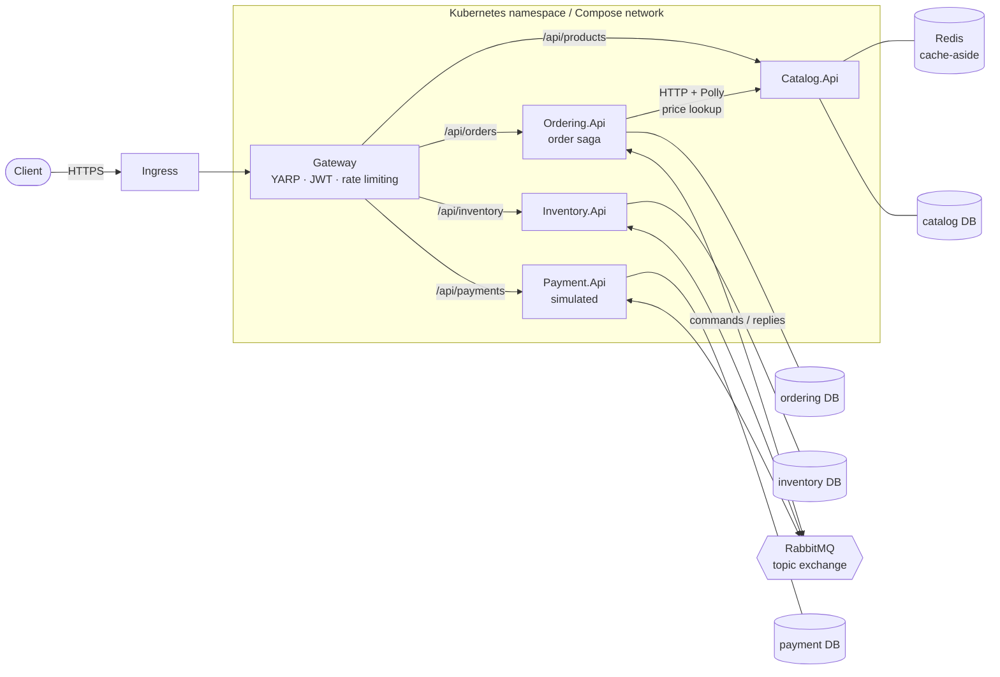
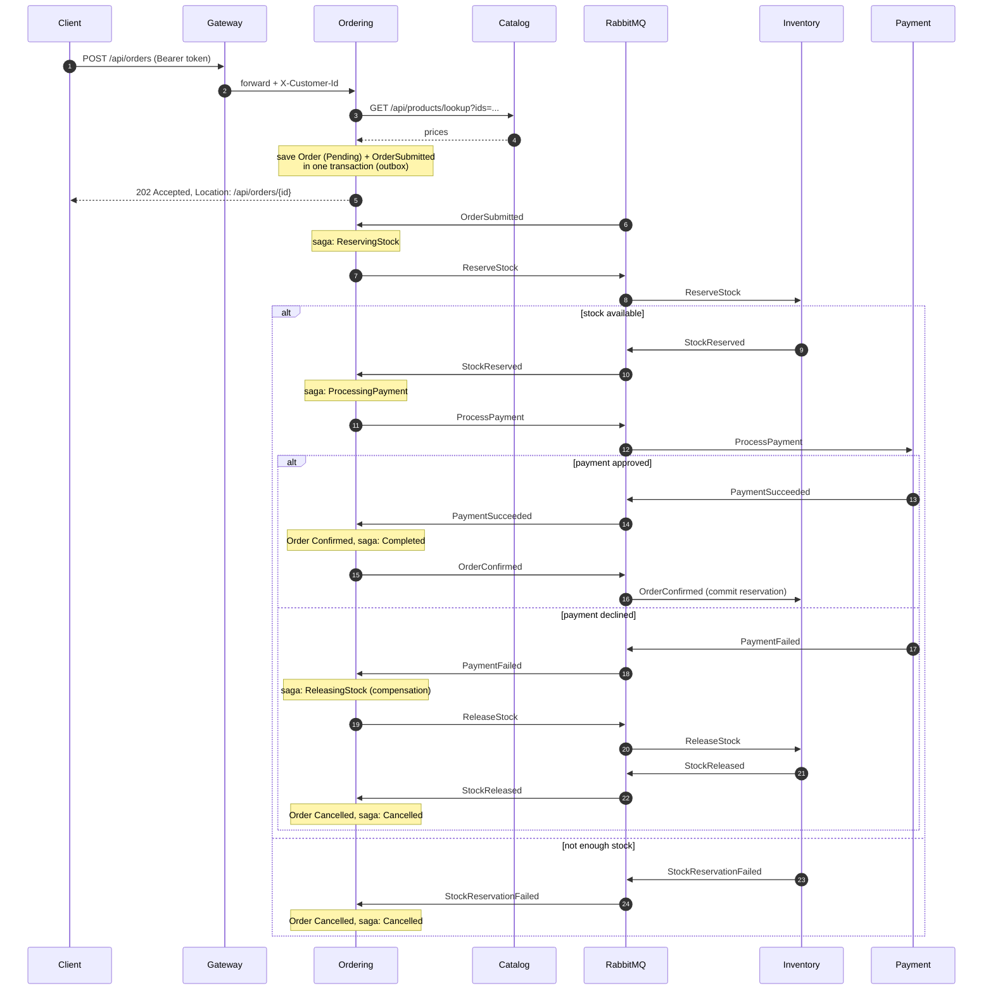

# ecommerce-microservices-k8s

A small e-commerce backend built as .NET 8 microservices: a YARP API gateway in front of
catalog, ordering, inventory and payment services that coordinate an order through an
orchestrated saga over RabbitMQ. It runs locally with `dotnet run`, as a full stack with
Docker Compose, and on Kubernetes through Kustomize overlays. A Terraform example shows how
an AKS cluster for it could be provisioned.

The services are deliberately small. The point of the repository is the plumbing between
them: the transactional outbox, idempotent consumers, a persisted saga with compensation,
resilience policies, and the observability and deployment setup around them.

## Architecture



Each service owns its own PostgreSQL database (four databases on one server in Compose and
in the dev overlay). Services never read each other's data; ordering asks the catalog for
prices over HTTP and talks to inventory and payment only through messages.

| Component | Responsibility | Storage |
|---|---|---|
| `Gateway` | Routes requests, validates JWTs, enforces per-client rate limits, sets `X-Customer-Id` from the token, propagates `X-Correlation-ID` | none |
| `Catalog.Api` | Products: list, read, batch lookup, create, update. Reads go through a Redis cache-aside layer | PostgreSQL, Redis |
| `Ordering.Api` | Accepts orders (`Order` aggregate) and runs the order saga | PostgreSQL |
| `Inventory.Api` | Stock levels and per-order reservations (reserve, release, commit) | PostgreSQL |
| `Payment.Api` | Simulated payment provider with configurable, deterministic declines | PostgreSQL |
| `BuildingBlocks` | Message contracts, RabbitMQ transport, outbox, inbox, OpenTelemetry, Serilog, health checks, correlation ids | - |

## The order saga

Placing an order is accepted synchronously (`202 Accepted`) and completed asynchronously.
`Ordering.Api` orchestrates the steps; its `OrderSaga` row records where each order is, so
the process survives restarts and redeliveries.



Saga states: `ReservingStock → ProcessingPayment → Completed`, with
`ReservingStock → Cancelled` when stock is missing and
`ProcessingPayment → ReleasingStock → Cancelled` when payment fails. A message that arrives
in a state that does not expect it (a duplicate, or a late reply) is logged and ignored.
Every step commits the saga row, the order and the outgoing commands in one transaction.

The seed data makes each path reachable without setup:

| Order | Result |
|---|---|
| keyboard, mouse or monitor | confirmed |
| USB headset (seeded with 0 stock) | cancelled: stock reservation failed |
| Thunderbolt dock (1249.00, above the 1000 decline limit) | stock reserved, payment declined, stock released, cancelled |
| any order by the customer `declined-customer` | payment declined, compensated, cancelled |

## Messaging and reliability

- **Transport.** One durable topic exchange (`ecommerce`); the routing key is the message
  type name. Each service declares its own durable queue bound to the types it handles,
  plus a dead-letter exchange and queue (`<service>.dead-letter`).
- **Transactional outbox.** Handlers and endpoints never publish directly. They add messages
  to an `outbox_messages` table in the same `SaveChanges` as the business change. A
  background dispatcher publishes them in order with publisher confirms and the `mandatory`
  flag; it is woken right after a commit and also polls as a fallback. A failed publish is
  recorded and retried on the next pass, up to a configurable number of attempts.
- **Idempotent consumers.** Every consumed message is recorded in `inbox_messages`, keyed by
  (message id, consumer), in the same transaction as the handler's changes and outgoing
  messages. A redelivered message is acknowledged without running the handler again. If two
  replicas process the same message at once, the primary key rejects the second commit and
  it is treated as a duplicate.
- **Retries.** A failing handler is retried with exponential backoff and jitter (Polly),
  each attempt in a fresh DI scope so half-applied changes are discarded. After the last
  retry, or immediately for an unknown type or unreadable body, the message is
  dead-lettered.
- **Concurrency.** Saga and stock rows use PostgreSQL's `xmin` as a row version. Two orders
  competing for the last unit, or two handlers touching the same saga, cannot both commit;
  the loser is retried against fresh data.
- **Business-level idempotency.** Inventory answers a repeated `ReserveStock` with the
  existing reservation, and payment never charges an order twice (unique index on the order
  id); a repeated command gets the stored outcome.
- **HTTP resilience.** Ordering calls the catalog through `HttpClientFactory` with the
  standard resilience pipeline from `Microsoft.Extensions.Http.Resilience` (Polly v8):
  total and per-attempt timeouts, retries with jittered backoff and a circuit breaker. If
  the catalog is still unavailable the API answers `503`.

Delivery is at-least-once end to end; the inbox is what turns that into effectively-once
processing per service.

## Gateway

- **Routing** is configuration (`ReverseProxy` in `src/Gateway/appsettings.json`):
  `GET /api/products/**` is public, `POST|PUT /api/products/**`, `/api/inventory/**` and
  `/api/payments/**` need the `admin` role, and `/api/orders/**` needs any authenticated
  user.
- **JWT validation** uses an OpenID Connect authority (`Jwt:Authority`) when configured,
  otherwise a symmetric signing key (`Jwt:SigningKey`). For local work and the dev overlay,
  `POST /auth/dev-token` issues tokens; it is off by default and in the prod overlay.
- **Customer identity.** The gateway removes any `X-Customer-Id` sent by the client and sets
  it from the token's `sub` claim. The services trust this header, which is why the
  Kubernetes manifests include NetworkPolicies that only let the gateway (and ordering, for
  catalog lookups) reach them.
- **Rate limiting** uses the ASP.NET Core rate limiter: a fixed window per subject, or per
  client IP for anonymous calls, answering `429` with `Retry-After`. Limits are in memory,
  so each gateway replica counts separately.
- **Correlation ids.** An incoming `X-Correlation-ID` is kept (if well formed) or created,
  forwarded to the services, returned on the response, carried in message properties
  through the saga and attached to every log line.

## Observability

- **Logs:** Serilog to the console, plain text locally and compact JSON in containers
  (`Observability:JsonLogs`), enriched with the service name and correlation id.
- **Traces and metrics:** OpenTelemetry for ASP.NET Core, `HttpClient` and the runtime, plus
  custom spans for publishing and consuming messages (W3C trace context travels in a
  `traceparent` message header, so one trace follows an order across services) and custom
  counters for published/processed messages, saga transitions and cache hits. Export over
  OTLP is enabled by setting `OpenTelemetry:OtlpEndpoint`.
- **Health:** `/health/live` (process is up) and `/health/ready` (PostgreSQL, RabbitMQ and,
  for the catalog, Redis). A Redis outage only marks the catalog as degraded, because reads
  fall back to the database.

## Running it

Prerequisites: .NET 8 SDK and Docker. `kubectl` (with a local cluster such as kind) for the
Kubernetes path.

### Docker Compose

```bash
docker compose up --build
```

The gateway listens on `http://localhost:8080` and the RabbitMQ management UI on
`http://localhost:15672` (user and password `ecommerce`). To collect traces in Jaeger:

```bash
OTLP_ENDPOINT=http://jaeger:4317 docker compose --profile observability up --build
# Jaeger UI: http://localhost:16686
```

Place an order through the gateway:

```bash
# 1. Get a token from the dev token endpoint (enabled in the compose file)
TOKEN=$(curl -s -X POST localhost:8080/auth/dev-token \
  -H 'Content-Type: application/json' \
  -d '{"subject":"alice","roles":["customer"]}' | jq -r .accessToken)

# 2. Browse the catalog (public)
curl -s localhost:8080/api/products | jq

# 3. Order two keyboards and a mouse
curl -s -X POST localhost:8080/api/orders \
  -H "Authorization: Bearer $TOKEN" -H 'Content-Type: application/json' \
  -d '{"items":[{"productId":"8f3c2a4e-1b6d-4c1a-9e57-0a1f5b2c3d01","quantity":2},
               {"productId":"8f3c2a4e-1b6d-4c1a-9e57-0a1f5b2c3d02","quantity":1}]}' | jq

# 4. Follow the order: status Pending -> Confirmed, progress -> Completed
curl -s localhost:8080/api/orders/<order id> -H "Authorization: Bearer $TOKEN" | jq
```

Ordering the dock (`...3d05`) shows the compensation path; ordering the headset (`...3d04`)
shows a failed reservation. With an `admin` token you can inspect stock
(`GET /api/inventory/{productId}`) and payments (`GET /api/payments/{orderId}`).
`requests.http` contains the same calls for editors that run `.http` files.

### Services on the host

Start only the infrastructure with its ports published, then run the projects:

```bash
docker compose -f docker-compose.yml -f docker-compose.ports.yml up -d postgres rabbitmq redis

dotnet run --project src/Services/Catalog/Catalog.Api      # http://localhost:5101
dotnet run --project src/Services/Ordering/Ordering.Api    # http://localhost:5102
dotnet run --project src/Services/Inventory/Inventory.Api  # http://localhost:5103
dotnet run --project src/Services/Payment/Payment.Api      # http://localhost:5104
dotnet run --project src/Gateway                           # http://localhost:5100
```

The `Development` settings of the gateway enable the dev token endpoint with a local
signing key. Each service applies its EF Core migrations at startup.

### Kubernetes

The manifests live in `deploy/k8s`:

- `base/`: Deployments (non-root, read-only root filesystem, startup/liveness/readiness
  probes, resource requests and limits), Services, HPAs, PodDisruptionBudgets, the gateway
  Ingress, ConfigMaps, NetworkPolicies, and `secret.example.yaml` as a template for the
  `ecommerce-secrets` Secret (not applied by Kustomize).
- `overlays/dev/`: one replica of everything, in-cluster PostgreSQL, RabbitMQ and Redis
  without persistence, generated throwaway secrets, the dev token endpoint enabled, images
  tagged `local`.
- `overlays/prod/`: images from a registry, external RabbitMQ and OTLP collector, an OIDC
  authority instead of the dev token endpoint, TLS on the Ingress, higher HPA limits for the
  gateway and ordering, and topology spread constraints. Hostnames, registry and authority
  are placeholders.

With kind and an ingress-nginx controller:

```bash
for image in catalog-api ordering-api inventory-api payment-api gateway; do
  kind load docker-image ecommerce/$image:local
done
kubectl apply -k deploy/k8s/overlays/dev
kubectl -n ecommerce-dev get pods
```

(`docker compose build` produces the `ecommerce/*:local` images.) For prod, create the
`ecommerce-secrets` Secret in the `ecommerce` namespace first, then
`kubectl apply -k deploy/k8s/overlays/prod`. To see what an overlay produces without a
cluster: `kubectl kustomize deploy/k8s/overlays/prod`.

### Terraform (example)

`deploy/terraform` is an **example** of provisioning an AKS cluster for these manifests with
the `azurerm` provider. It has not been applied to a real subscription as part of this
repository. The `modules/aks` module creates:

- a Log Analytics workspace for Container Insights,
- an AKS cluster with a system node pool (critical add-ons only) and an autoscaled `apps`
  pool, Azure CNI overlay with Calico (so the NetworkPolicies are enforced), OIDC issuer and
  workload identity,
- optionally an Azure Container Registry with an `AcrPull` assignment for the kubelet.

```bash
cd deploy/terraform
cp terraform.tfvars.example terraform.tfvars   # adjust names and region
export ARM_SUBSCRIPTION_ID=<subscription id>
terraform init && terraform plan
```

## Configuration

Settings use the standard ASP.NET Core configuration sources; in containers they are set
with environment variables (`Section__Key`).

| Setting | Used by | Default / example |
|---|---|---|
| `ConnectionStrings:CatalogDb` / `OrderingDb` / `InventoryDb` / `PaymentDb` | each service | `Host=localhost;Database=<service>;...` |
| `ConnectionStrings:Redis` | catalog | `localhost:6379`; empty uses an in-memory cache |
| `Catalog:Cache:TimeToLive` | catalog | `00:05:00` |
| `RabbitMq:Host`, `Port`, `UserName`, `Password`, `Exchange` | messaging services | `localhost`, `5672`, `ecommerce`, `ecommerce`, `ecommerce` |
| `RabbitMq:RetryCount`, `RetryBaseDelay`, `PrefetchCount` | messaging services | `3`, `00:00:00.2`, `16` |
| `Outbox:PollingInterval`, `BatchSize`, `MaxAttempts`, `Retention` | messaging services | `2s`, `50`, `10`, `7 days` |
| `Services:Catalog` | ordering | `http://localhost:5101` |
| `PaymentSimulation:DeclineAmountsAbove` | payment | `1000` (null disables) |
| `PaymentSimulation:DeclinedCustomerIds` | payment | `["declined-customer"]` |
| `PaymentSimulation:SupportedCurrencies` | payment | `["USD"]` |
| `Jwt:Authority` or `Jwt:SigningKey` | gateway | one of them is required |
| `Jwt:Issuer`, `Jwt:Audience` | gateway | `ecommerce-gateway`, `ecommerce-api` |
| `Jwt:EnableDevTokenEndpoint` | gateway | `false` (`true` in Development, Compose and the dev overlay) |
| `RateLimiting:PermitLimit`, `Window` | gateway | `100` per `00:00:10` |
| `ReverseProxy:Clusters:<name>:Destinations:primary:Address` | gateway | `http://localhost:510x` |
| `Gateway:TrustAllProxies` | gateway | `false`; `true` behind the ingress so `X-Forwarded-For` is honoured |
| `OpenTelemetry:OtlpEndpoint`, `Protocol` | all | unset (no export), `Grpc` |
| `Observability:JsonLogs` | all | `false`; `true` in the container images |
| `Database:MigrateOnStartup` | services | `true` |

## Tests

```bash
dotnet test
```

| Project | Covers |
|---|---|
| `BuildingBlocks.Tests` | Outbox dispatcher (ordering, failure handling, max attempts, batching), outbox enqueue, idempotent consumer (duplicates, retries, atomic commit of outgoing messages, rejected deliveries, losing a race with a concurrent delivery). Runs against in-memory SQLite. |
| `Ordering.Tests` | `Order` aggregate invariants and state changes; saga transitions including both compensation paths and ignored out-of-order messages |
| `Inventory.Tests` | All-or-nothing reservations, release and commit |
| `Payment.Tests` | Payment simulator rules |
| `Gateway.Tests` | Route table loaded from configuration, plus the running gateway in memory: authentication, role checks, rate limiting per client, correlation ids, dev token validation |

The CI workflow (`.github/workflows/ci.yml`) builds and tests the solution, builds each
Docker image in a matrix, renders both Kustomize overlays, validates the Compose files and
runs `terraform fmt -check` and `terraform validate`.

## Design decisions and trade-offs

- **Orchestration over choreography.** The order flow has a clear owner and an explicit
  state machine that is easy to test in isolation (`OrderSaga` has no I/O). The cost is that
  ordering knows about every step.
- **Outbox and inbox per service database** instead of a distributed transaction. This gives
  atomic "change + message" without 2PC, at the price of extra tables, a dispatcher loop and
  at-least-once delivery that every consumer must tolerate.
- **RabbitMQ.Client directly** rather than a messaging framework, to keep the outbox, inbox,
  retry and dead-letter behaviour visible in a few hundred lines of code.
- **One currency** (`USD`) for the catalog; the order aggregate still checks that all lines
  share a currency so the invariant is enforced, not assumed.
- **Trusting a gateway header** for customer identity keeps the services simple, but relies
  on network isolation (NetworkPolicies) so nothing else can call them directly.
- **Migrations at startup** keep the demo self-contained. EF Core 8 does not lock during
  migrations, so concurrent replicas applying a new migration is a risk; a separate
  migration job would be the safer choice for real deployments.

Known gaps: no saga timeouts (an order waits indefinitely if a service never replies), no
admin tooling for dead-lettered messages or outbox rows that exhausted their attempts, rate
limits are not shared between gateway replicas, and there is no real payment integration.

## Repository layout

```
.
├── src/
│   ├── BuildingBlocks/          # messaging, outbox, inbox, observability, health, persistence helpers
│   ├── Gateway/                 # YARP gateway
│   └── Services/
│       ├── Catalog/Catalog.Api/
│       ├── Ordering/Ordering.Api/   # Domain/ (Order), Saga/ (OrderSaga + handler), Orders/ (API)
│       ├── Inventory/Inventory.Api/
│       └── Payment/Payment.Api/
├── tests/                       # xUnit test projects, one per component
├── deploy/
│   ├── docker/postgres/         # database init script for Compose
│   ├── k8s/                     # Kustomize base + dev/prod overlays
│   └── terraform/               # example AKS root module + modules/aks
├── docker-compose.yml           # full local stack (+ optional Jaeger profile)
├── docker-compose.ports.yml     # publishes infrastructure ports for `dotnet run`
├── requests.http                # sample requests through the gateway
└── .github/workflows/ci.yml
```

## License

[MIT](LICENSE)
