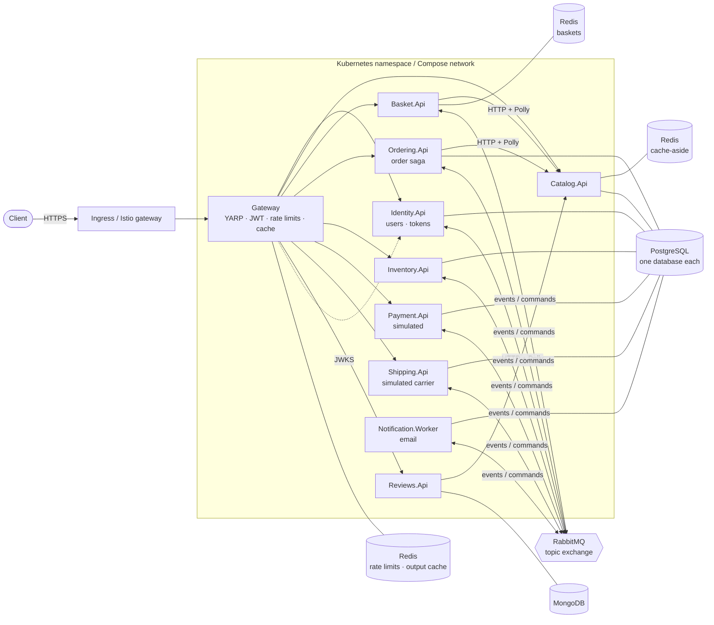
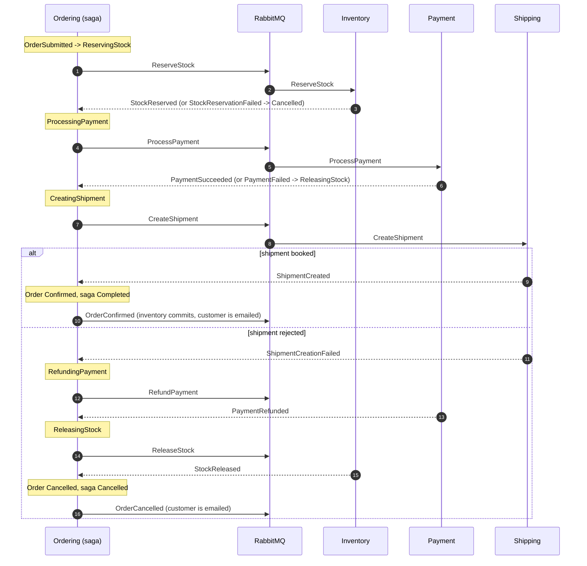

# ecommerce-microservices-k8s

An e-commerce backend built as ten .NET 8 deployables: a YARP API gateway, eight HTTP
services and a background worker. Orders run through an orchestrated saga over RabbitMQ
(stock, payment, shipping, with compensation and timeouts). It runs locally with
`dotnet run`, as a full stack with Docker Compose (optionally with an observability
profile), and on Kubernetes through Kustomize overlays, an Istio variant or a Helm chart.
Terraform shows how the Azure side (zonal AKS, PostgreSQL, Redis, ACR, Key Vault, Log
Analytics) could be provisioned.

The services are deliberately small. The point of the repository is the plumbing between
them: the transactional outbox, idempotent consumers, a persisted saga with compensation and
timeouts, dead-letter tooling, token issuing and validation, distributed rate limiting, and
the observability and deployment setup around them.

## Architecture



Each service owns its data. Nobody reads another service's database; services talk over
HTTP only for price and product lookups from the catalog, and otherwise through messages.

| Component | Responsibility | Storage |
|---|---|---|
| `Gateway` | Routes requests, validates JWTs (identity service and optional dev tokens), per-client rate limits shared through Redis, output cache for catalog reads, request/response size limits, sets `X-Customer-Id` from the token, propagates `X-Correlation-ID` | Redis (optional) |
| `Identity.Api` | Registration, password login with lockout, RS256 access tokens, rotating refresh tokens with reuse detection, roles, OIDC discovery and JWKS | PostgreSQL (ASP.NET Core Identity) |
| `Catalog.Api` | Products: list, read, batch lookup, create, update; reads go through a Redis cache-aside layer | PostgreSQL, Redis |
| `Basket.Api` | Per-customer baskets; checkout prices the items with the catalog and publishes `BasketCheckedOut` | Redis |
| `Ordering.Api` | `Order` aggregate, orders from the API or from basket checkouts, the order saga and its timeouts | PostgreSQL |
| `Inventory.Api` | Stock levels and per-order reservations (reserve, release, commit) | PostgreSQL |
| `Payment.Api` | Simulated payment provider with deterministic declines; refunds and voids | PostgreSQL |
| `Shipping.Api` | Books shipments for the saga (simulated carrier rules), tracking history, dispatch and delivery updates | PostgreSQL |
| `Reviews.Api` | One review per customer and product, rating summaries (count, average, stars) | MongoDB |
| `Notification.Worker` | Emails customers on registration, confirmation, cancellation, dispatch and delivery; file or SMTP sink | PostgreSQL |
| `BuildingBlocks` | Message contracts, RabbitMQ transport, outbox, inbox, dead-letter and outbox admin endpoints, OpenTelemetry, Serilog, health checks, correlation ids | - |
| `tools/DeadLetters.Cli` | Lists, replays and discards dead-lettered messages directly against RabbitMQ | - |

## The order saga

Placing an order (directly, or by checking out a basket) is accepted with `202 Accepted` and
completed asynchronously. `Ordering.Api` orchestrates the steps; its `OrderSaga` row records
where each order is, so the process survives restarts and redeliveries.



States: `ReservingStock → ProcessingPayment → CreatingShipment → Completed`. Failures undo
the completed steps in reverse order: a failed reservation cancels straight away, a failed
payment releases the stock, and a failed shipment refunds the payment and then releases the
stock. A message that arrives in a state that does not expect it (a duplicate, or a late
reply) is logged and ignored. Every step commits the saga row, the order and the outgoing
commands in one transaction, and every cancellation publishes `OrderCancelled`.

**Timeouts.** A background scan in ordering (`Saga:ScanInterval`, 30 seconds) looks for
sagas that have waited in one state for longer than `Saga:StepTimeout` (5 minutes) and gives
the step up. Because the reply may still be on its way, a timeout compensates everything that
might have happened:

| Waiting in | On timeout | Why it is safe against a late reply |
|---|---|---|
| `ReservingStock` | `ReleaseStock` → `ReleasingStock` | Inventory records the release even without a reservation, so a late `ReserveStock` reserves nothing |
| `ProcessingPayment` | `RefundPayment` → `RefundingPayment` | A refund before the charge records a voided payment; a late `ProcessPayment` is answered with a failure |
| `CreatingShipment` | `CancelShipment` + `RefundPayment` → `RefundingPayment` | A cancellation before the booking leaves a cancelled shipment; a late `CreateShipment` fails |
| `RefundingPayment`, `ReleasingStock` | the compensation command is sent again | both commands are idempotent |

Each timed-out saga commits on its own, and the saga row version makes a timeout lose
cleanly against a reply processed at the same moment (or against another replica's scan).

The seed data makes each path reachable without setup:

| Order | Result |
|---|---|
| keyboard, mouse or monitor | confirmed, with a tracking number |
| USB headset (seeded with 0 stock) | cancelled: stock reservation failed |
| Thunderbolt dock (1249.00, above the 1000 decline limit) | payment declined, stock released, cancelled |
| any order by the customer `declined-customer` | payment declined, stock released, cancelled |
| any order by the customer `unshippable-customer` | shipment rejected, payment refunded, stock released, cancelled |

## Messaging and reliability

- **Transport.** One durable topic exchange (`ecommerce`); the routing key is the message
  type name. Each consuming service declares its own durable queue bound to the types it
  handles, plus a dead-letter exchange and queue (`<service>.dead-letter`).
- **Transactional outbox.** Handlers and endpoints in services with a database add messages
  to an `outbox_messages` table in the same `SaveChanges` as the business change. A
  dispatcher publishes them in order with publisher confirms and the `mandatory` flag.
  The basket service has no database; it publishes a checkout directly and waits for the
  broker's confirm before it deletes the basket, and reuses the order id it reserved if the
  checkout is retried.
- **Idempotent consumers.** Every consumed message is recorded in `inbox_messages`, keyed by
  (message id, consumer), in the same transaction as the handler's changes and outgoing
  messages. Commands are also idempotent at the business level: one reservation, one
  payment, one shipment per order, and a repeated command gets the stored outcome.
- **Retries and dead letters.** A failing handler is retried with exponential backoff and
  jitter (Polly), each attempt in a fresh DI scope. After the last retry, or immediately for
  an unknown type or unreadable body, the message is dead-lettered.
- **Dead-letter tooling.** Every consuming service maps `GET /admin/dead-letters`,
  `POST /admin/dead-letters/replay` (selected ids or all) and `POST /admin/dead-letters/discard`;
  the gateway exposes them to admins as `/api/admin/{service}/dead-letters`. Messages are
  fetched without auto-ack on a short-lived channel, so anything not replayed or discarded
  returns to the queue. A replay goes through the default exchange to the service's own queue
  only, so other subscribers do not see the message twice, and carries an `x-replay-count`
  header. `tools/DeadLetters.Cli` does the same against the broker directly:

  ```bash
  dotnet run --project tools/DeadLetters.Cli -- list ordering
  dotnet run --project tools/DeadLetters.Cli -- replay ordering --id <message id>
  ```
- **Stuck outbox rows.** `GET /admin/outbox/failed` lists messages the dispatcher gave up on
  after `Outbox:MaxAttempts`, and `POST /admin/outbox/failed/retry` sends them again.
- **Concurrency.** Saga, stock and shipment rows use PostgreSQL's `xmin` as a row version,
  so two handlers touching the same row cannot both commit; the loser is retried against
  fresh data.
- **HTTP resilience.** Calls to the catalog go through `HttpClientFactory` with the standard
  resilience pipeline from `Microsoft.Extensions.Http.Resilience` (timeouts, retries with
  jittered backoff, circuit breaker); if the catalog is still unavailable the caller answers
  `503`.

Delivery is at-least-once end to end; the inbox is what turns that into effectively-once
processing per service. Email is the exception: it is sent before the inbox commits, so a
crash in between can send one twice.

## Identity and the gateway

- **Accounts and tokens.** `POST /api/identity/register` and `POST /api/identity/token`
  return an RS256 access token (15 minutes) and a refresh token (14 days). Refresh tokens are
  stored as SHA-256 hashes and are single use: `POST /api/identity/token/refresh` revokes the
  presented token and issues its successor, and presenting an already used token revokes the
  whole session. Five failed logins lock an account for five minutes. Admins change roles
  with `PUT /api/identity/users/{id}/roles`, which also ends the user's sessions.
- **Validation.** The gateway sets `Jwt:Authority` to the identity service and reads the
  issuer and signing keys from its `/.well-known/openid-configuration` and JWKS. When a
  `Jwt:SigningKey` is also configured, HMAC dev tokens from `POST /auth/dev-token` are
  accepted as well (Development, Compose and the dev overlay only).
- **Routing and authorization** are configuration (`ReverseProxy` in
  `src/Gateway/appsettings.json`): catalog and review reads, registration and token requests
  are public; orders, basket, own shipments, reviews and `/api/identity/me` need a signed-in
  customer; catalog writes, inventory, payments, shipment status updates and
  `/api/admin/**` need the `admin` role.
- **Customer identity.** The gateway removes any `X-Customer-Id` sent by the client and sets
  it from the token's `sub` claim. The services trust this header, which is why the
  Kubernetes manifests only let the gateway (and the catalog's internal callers) reach them.
- **Rate limiting.** A fixed window per subject, or per client IP for anonymous calls,
  answering `429` with `Retry-After`. With `ConnectionStrings:Redis` set the counters live in
  Redis (INCR and expiry in one Lua script), so every gateway replica enforces the same
  limit; while Redis is unreachable each replica counts locally instead of failing requests.
- **Catalog cache.** Anonymous catalog GETs use ASP.NET Core output caching (30 seconds,
  varied by query string, in Redis when configured); a successful product change through the
  gateway evicts them.
- **Size limits.** Requests over `Gateway:Limits:MaxRequestBodyBytes` (1 MiB) get `413`
  before anything is forwarded; service responses over `MaxResponseBodyBytes` (10 MiB) get
  `502`, or are cut off if they do not declare a length.

## Observability

- **Logs:** Serilog to the console (plain text locally, compact JSON in containers), enriched
  with the service name and correlation id. With OTLP export configured, every event also goes
  to the OpenTelemetry logger provider and on to Loki with its trace id.
- **Traces and metrics:** OpenTelemetry for ASP.NET Core, `HttpClient` and the runtime, plus
  custom spans for publishing and consuming messages (W3C trace context travels in a
  `traceparent` header, so one trace follows an order across services) and counters for
  published/processed messages, saga transitions and timeouts, cache hits and emails sent.
- **Stack:** an OpenTelemetry Collector receives OTLP and sends traces to Jaeger, logs to Loki
  and metrics to a Prometheus exporter that Prometheus scrapes (with RabbitMQ's per-queue
  metrics). Grafana is provisioned with the three datasources (trace-to-log links) and two
  dashboards: *Services: rate, errors, duration* and *Order saga outcomes* (completed vs
  cancelled, timeouts by state, message outcomes, dead-letter queue depth). The same config
  files (`deploy/k8s/observability/config`) serve Compose and Kubernetes.
- **Health:** `/health/live` (process is up) and `/health/ready` (the service's own
  database, broker and cache). A Redis outage only marks the catalog as degraded, because
  reads fall back to the database.

## Running it

Prerequisites: .NET 8 SDK and Docker. `kubectl` (with a local cluster such as kind) for the
Kubernetes path, Helm 3 for the chart, Terraform 1.6+ for the Azure example.

### Docker Compose

```bash
docker compose up --build
# with telemetry, Grafana on http://localhost:3000, Jaeger on http://localhost:16686
OTLP_ENDPOINT=http://otel-collector:4317 docker compose --profile observability up --build
```

The gateway listens on `http://localhost:8080`, the RabbitMQ management UI on
`http://localhost:15672` (user and password `ecommerce`) and Mailpit, which catches the
notification emails, on `http://localhost:8025`. The databases are created by
`deploy/docker/postgres/init-databases.sql` when the PostgreSQL volume is first created; after
pulling new services, recreate it with `docker compose down -v`.

```bash
# 1. Register (or use the seeded admin@ecommerce.local / Admin-Passw0rd!)
TOKEN=$(curl -s -X POST localhost:8080/api/identity/register -H 'Content-Type: application/json' \
  -d '{"email":"alice@example.com","password":"Correct-Horse-9","displayName":"Alice"}' | jq -r .accessToken)

# 2. Fill the basket and check out
curl -s -X PUT localhost:8080/api/basket/items/8f3c2a4e-1b6d-4c1a-9e57-0a1f5b2c3d01 \
  -H "Authorization: Bearer $TOKEN" -H 'Content-Type: application/json' -d '{"quantity":2}'
ORDER=$(curl -s -X POST localhost:8080/api/basket/checkout -H "Authorization: Bearer $TOKEN" | jq -r .orderId)

# 3. Follow the order: Pending -> Confirmed, with a tracking number
curl -s localhost:8080/api/orders/$ORDER -H "Authorization: Bearer $TOKEN" | jq
```

`requests.http` has these and the other flows (refresh tokens, reviews, shipment tracking,
the failure paths, dead-letter replay) for editors that run `.http` files.

### Services on the host

Start only the infrastructure with its ports published, then run the projects:

```bash
docker compose -f docker-compose.yml -f docker-compose.ports.yml up -d postgres rabbitmq redis mongo

dotnet run --project src/Services/Catalog/Catalog.Api              # http://localhost:5101
dotnet run --project src/Services/Ordering/Ordering.Api            # http://localhost:5102
dotnet run --project src/Services/Inventory/Inventory.Api          # http://localhost:5103
dotnet run --project src/Services/Payment/Payment.Api              # http://localhost:5104
dotnet run --project src/Services/Identity/Identity.Api            # http://localhost:5105
dotnet run --project src/Services/Basket/Basket.Api                # http://localhost:5106
dotnet run --project src/Services/Shipping/Shipping.Api            # http://localhost:5107
dotnet run --project src/Services/Reviews/Reviews.Api              # http://localhost:5108
dotnet run --project src/Services/Notification/Notification.Worker # http://localhost:5109, emails in ./mail
dotnet run --project src/Gateway                                   # http://localhost:5100
```

In `Development` the identity service generates its signing key at startup and seeds the
admin account, and the gateway accepts both its tokens and dev tokens. Each service with a
relational database applies its EF Core migrations at startup.

### Kubernetes

The manifests live in `deploy/k8s`:

- `base/`: the ten workloads, each with a Deployment, Service, PodDisruptionBudget
  (`maxUnavailable: 1`) and, for the APIs, an HPA on CPU and memory; ConfigMaps,
  NetworkPolicies, the gateway Ingress, and `secret.example.yaml` as a template for the
  `ecommerce-secrets` Secret (not applied by Kustomize).
- Every Deployment spreads its pods over zones and then nodes (topology spread constraints),
  prefers one pod per node (pod anti-affinity), runs non-root with a read-only root
  filesystem and resource requests and limits, and has startup, liveness and readiness
  probes. Readiness checks the service's own dependencies, `minReadySeconds` holds a rollout
  until new pods have stayed ready, and a short `preStop` delay lets endpoint removal reach
  the proxies before shutdown. Pod `readinessGates` are not used: no controller in this
  setup sets a custom pod condition, so the readiness probe is the gate.
- `overlays/dev/`: one replica of everything, in-cluster PostgreSQL, MongoDB, RabbitMQ and
  Redis without persistence, generated throwaway secrets, the dev token endpoint and a
  generated identity signing key, images tagged `local`.
- `overlays/prod/`: at least three replicas per workload with zone spreading as a hard rule
  (`DoNotSchedule`), images from a registry, external infrastructure, telemetry to the
  collector, TLS on the Ingress. Hostnames and the registry are placeholders.
- `istio/`: the prod overlay inside an Istio mesh: sidecar injection, STRICT mutual TLS
  (`PeerAuthentication`), an Istio `Gateway` and `VirtualService` instead of the nginx
  Ingress, and a `DestinationRule` per workload with connection pools, outlier detection and
  locality-aware failover between zones.
- `observability/`: the collector, Jaeger, Prometheus, Loki and Grafana in their own
  namespace (single replicas, ephemeral storage).

With kind and an ingress-nginx controller:

```bash
docker compose build
for image in catalog-api ordering-api inventory-api payment-api identity-api basket-api \
             shipping-api reviews-api notification-worker gateway; do
  kind load docker-image ecommerce/$image:local
done
kubectl apply -k deploy/k8s/overlays/dev
kubectl apply -k deploy/k8s/observability   # optional
kubectl -n ecommerce-dev get pods
```

For prod, create the `ecommerce-secrets` Secret (including `identity-signing-key`) in the
`ecommerce` namespace first, then `kubectl apply -k deploy/k8s/overlays/prod`, or
`kubectl kustomize deploy/k8s/istio | kubectl apply -f -` on a cluster with Istio. To see what
an overlay produces without a cluster: `kubectl kustomize deploy/k8s/overlays/prod`.

### Helm

`deploy/helm/ecommerce` renders the same workloads from one values map (`services:` in
`values.yaml`, with per-service `env`, `secretEnv`, `allowFrom`, `resources` and replica
settings). `values-dev.yaml` and `values-prod.yaml` mirror the two overlays.

```bash
helm lint deploy/helm/ecommerce
helm upgrade --install ecommerce deploy/helm/ecommerce -n ecommerce --create-namespace \
  -f deploy/helm/ecommerce/values-prod.yaml
```

### Terraform (example)

`deploy/terraform` is an **example** of provisioning the Azure side with the `azurerm`
provider. It has not been applied to a real subscription as part of this repository.
`environments/dev` and `environments/prod` hold the root configurations and their
non-secret `terraform.tfvars`; both call `modules/platform`, which creates:

- a virtual network with subnets for the nodes, PostgreSQL (delegated) and private endpoints;
- `modules/aks`: a system pool spread over the zones and one autoscaled application pool per
  zone (so the autoscaler can add capacity in the zone that needs it), Azure CNI overlay with
  Calico, workload identity and the Key Vault secrets provider;
- `modules/postgres`: Flexible Server on the private network with zone-redundant HA (standby
  in a second zone), one database per service and a generated administrator password;
- `modules/redis`: Azure Cache for Redis behind a private endpoint; Premium with replicas in
  every zone in prod;
- `modules/acr` (zone-redundant Premium in prod, `AcrPull` for the kubelet identity),
  `modules/log-analytics` (Container Insights) and `modules/key-vault` (RBAC, the connection
  strings stored under the `ecommerce-secrets` key names, read access for the CSI driver).

Dev uses one zone, Burstable PostgreSQL without HA, Standard Redis and a Basic registry.
RabbitMQ (no managed offering on Azure) and MongoDB (for example Cosmos DB for MongoDB) are
not provisioned.

```bash
cd deploy/terraform/environments/prod
export ARM_SUBSCRIPTION_ID=<subscription id>
terraform init && terraform validate && terraform plan
```

## Configuration

Settings use the standard ASP.NET Core configuration sources; in containers they are set
with environment variables (`Section__Key`).

| Setting | Used by | Default / example |
|---|---|---|
| `ConnectionStrings:<Service>Db` | each service with a database | `Host=localhost;Database=<service>;...` (`ReviewsDb` is a MongoDB URL) |
| `ConnectionStrings:Redis` | catalog, basket, gateway | `localhost:6379`; required by the basket; empty gives the catalog an in-memory cache and the gateway per-replica limits and cache |
| `RabbitMq:Host`, `Port`, `UserName`, `Password`, `Exchange` | messaging services | `localhost`, `5672`, `ecommerce`, `ecommerce`, `ecommerce` |
| `RabbitMq:RetryCount`, `RetryBaseDelay`, `PrefetchCount` | messaging services | `3`, `00:00:00.2`, `16` |
| `Outbox:PollingInterval`, `BatchSize`, `MaxAttempts`, `Retention` | services with an outbox | `2s`, `50`, `10`, `7 days` |
| `Saga:StepTimeout`, `ScanInterval`, `BatchSize` | ordering | `00:05:00`, `00:00:30`, `100` |
| `Services:Catalog` | ordering, basket, reviews | `http://localhost:5101` |
| `Basket:TimeToLive` | basket | `30.00:00:00` (sliding) |
| `Identity:Issuer`, `Audience`, `AccessTokenLifetime`, `RefreshTokenLifetime` | identity | `ecommerce-identity`, `ecommerce-api`, `00:15:00`, `14.00:00:00` |
| `Identity:SigningKeyPem`, `SigningKeyId` | identity | RSA private key PEM (required unless `AllowEphemeralSigningKey`), `identity-1` |
| `Identity:SeedAdmin:Email`, `Password` | identity | unset; set in Development, Compose and the dev overlay |
| `PaymentSimulation:DeclineAmountsAbove`, `DeclinedCustomerIds`, `SupportedCurrencies` | payment | `1000`, `["declined-customer"]`, `["USD"]` |
| `ShippingRules:Carrier`, `MaxUnitsPerShipment`, `UnserviceableCustomerIds` | shipping | `Simulated Post`, `50`, `["unshippable-customer"]` |
| `Email:Sink`, `From`, `PickupDirectory`, `Smtp:*` | notification | `File`, `shop@ecommerce.local`, `mail`, SMTP host/port/credentials |
| `Jwt:Authority`, `RequireHttpsMetadata` | gateway | identity service URL; `false` only on a private network |
| `Jwt:SigningKey`, `Issuer`, `Audience`, `EnableDevTokenEndpoint` | gateway | dev tokens: key of 32+ characters, `ecommerce-gateway`, `ecommerce-api`, `false` |
| `RateLimiting:PermitLimit`, `Window` | gateway | `100` per `00:00:10` |
| `Gateway:CatalogCache:Duration` | gateway | `00:00:30` |
| `Gateway:Limits:MaxRequestBodyBytes`, `MaxResponseBodyBytes` | gateway | `1048576`, `10485760` |
| `Gateway:TrustAllProxies` | gateway | `false`; `true` behind the ingress so `X-Forwarded-For` is honoured |
| `OpenTelemetry:OtlpEndpoint`, `Protocol` | all | unset (no export), `Grpc` |
| `Observability:JsonLogs` | all | `false`; `true` in the container images |
| `Database:MigrateOnStartup` | services with EF Core | `true` |

## Tests

```bash
dotnet test
```

| Project | Tests | Covers |
|---|---|---|
| `BuildingBlocks.Tests` | 33 | Outbox dispatcher and enqueue, idempotent consumer (duplicates, retries, atomic commit, rejected deliveries, concurrent delivery), dead-letter listing, selective and full replay, failed replays, discard and the CLI's argument parsing |
| `Gateway.Tests` | 52 | Route table, authentication with dev tokens and with an RS256 authority (keys, issuer, roles), rate limiting per client and shared between two gateway instances through one store, Redis fallback, output caching and eviction against a stand-in catalog, request and response size limits, correlation ids |
| `Identity.Tests` | 19 | Registration, JWKS-validated access tokens, duplicate and weak input, lockout, refresh rotation and reuse detection, revocation, roles and role changes, outbox records, stuck-outbox retry endpoints |
| `Ordering.Tests` | 39 | `Order` invariants; saga transitions including the shipping step, all compensation paths, ignored out-of-order messages and timeouts per state; the timeout processor and basket checkout handler against SQLite |
| `Basket.Tests` | 19 | Basket rules, checkout (pricing, unknown products, catalog and broker outages, retries reusing the order id), API |
| `Payment.Tests` | 13 | Simulator rules; refunds, voids before a charge, repeated charges after a refund |
| `Shipping.Tests` | 10 | Booking and carrier rules, idempotent commands, cancellation before and after booking, tracking API |
| `Notification.Tests` | 10 | Each notification, unknown recipients, failed sends, file sink output and sink selection |
| `Reviews.Tests` | 16 | Rating summary maths, create/edit/delete keeping the summary in step, recompute, API |
| `Inventory.Tests` | 8 | All-or-nothing reservations, release, commit, release before reservation |

Handler tests run against in-memory SQLite (PostgreSQL row versions become plain columns
there), Redis and MongoDB are replaced by in-memory stores with the same contracts, and the
HTTP tests run the real services in memory. Nothing in the test suite needs Docker.

## Production considerations

What would still be needed, or decided, before running this for real:

- **Payment and shipping are simulations.** Real providers bring webhooks, partial refunds
  and their own idempotency keys, and a refund can fail; here it always succeeds.
- **Migrations at startup.** EF Core 8 takes no migration lock, so several replicas applying
  a new migration at once is a risk; a migration job before the rollout is the safer choice.
- **Secrets.** The Terraform example writes the connection strings to Key Vault, but the
  manifests read a plain `ecommerce-secrets` Secret; a `SecretProviderClass` (or External
  Secrets) syncing the vault into it is not included. The identity signing key has no
  rotation procedure beyond changing `SigningKeyId` with the key.
- **Stateful infrastructure.** The dev overlay and the observability manifests use single
  replicas with ephemeral storage. RabbitMQ in production needs a clustered deployment (for
  example the cluster operator, with quorum queues) and MongoDB a replica set; neither is
  provided here.
- **Messaging edge cases.** Publishing uses `mandatory`, so a message type with no bound
  queue stays in the outbox and blocks later messages of that service until a consumer
  exists. The rating summary and a review are two writes without a transaction and can drift
  until recomputed. Emails are at-least-once.
- **Capacity.** No load tests have been run; replica counts, HPA thresholds, rate limits and
  resource requests are starting values, not measured ones.
- **Validation tooling.** `kubectl kustomize` renders every overlay; the Helm chart and the
  Terraform configuration should be run through `helm lint` / `helm template` and
  `terraform validate` in CI before use.

## Design decisions and trade-offs

- **Orchestration over choreography.** The order flow has a clear owner and an explicit state
  machine that is easy to test in isolation (`OrderSaga` has no I/O). The cost is that
  ordering knows about every step.
- **Compensate on timeout instead of asking.** A step that times out is undone rather than
  queried, which needs every participant to accept a compensation that overtakes the original
  command. That is why release, refund and cancel each leave a record behind.
- **Outbox and inbox per service database** instead of a distributed transaction: atomic
  "change + message" without 2PC, at the price of extra tables, a dispatcher loop and
  at-least-once delivery that every consumer must tolerate.
- **RabbitMQ.Client directly** rather than a messaging framework, to keep the outbox, inbox,
  retry, dead-letter and replay behaviour visible in a few hundred lines of code.
- **An identity service of its own** issuing standard JWTs with discovery and JWKS, so the
  gateway validates them exactly as it would tokens from Entra ID or Keycloak; swapping the
  issuer is a configuration change.
- **Trusting a gateway header** for customer identity keeps the services simple, but relies
  on network isolation (NetworkPolicies, and mTLS in the Istio variant).
- **Prices are read at checkout**, never stored in the basket, so a basket cannot charge a
  stale price.

## Repository layout

```
.
├── src/
│   ├── BuildingBlocks/            # messaging, outbox, inbox, dead letters, observability, health, persistence helpers
│   ├── Gateway/                   # YARP gateway (Auth/, RateLimiting/, Caching/, Limits/)
│   └── Services/
│       ├── Catalog/Catalog.Api/
│       ├── Identity/Identity.Api/
│       ├── Basket/Basket.Api/
│       ├── Ordering/Ordering.Api/        # Domain/ (Order), Saga/ (OrderSaga, handler, timeouts), Orders/ (API, checkouts)
│       ├── Inventory/Inventory.Api/
│       ├── Payment/Payment.Api/
│       ├── Shipping/Shipping.Api/
│       ├── Reviews/Reviews.Api/
│       └── Notification/Notification.Worker/
├── tools/DeadLetters.Cli/         # dead-letter list / replay / discard against RabbitMQ
├── tests/                         # xUnit test projects, one per component
├── deploy/
│   ├── docker/postgres/           # database init script for Compose
│   ├── k8s/                       # Kustomize base, dev/prod overlays, istio/, observability/
│   ├── helm/ecommerce/            # Helm chart with dev and prod values
│   └── terraform/                 # environments/{dev,prod} + modules/{platform,aks,postgres,redis,acr,key-vault,log-analytics}
├── docker-compose.yml             # full local stack (+ "observability" profile)
├── docker-compose.ports.yml       # publishes infrastructure ports for `dotnet run`
└── requests.http                  # sample requests through the gateway
```

## License

[MIT](LICENSE)
